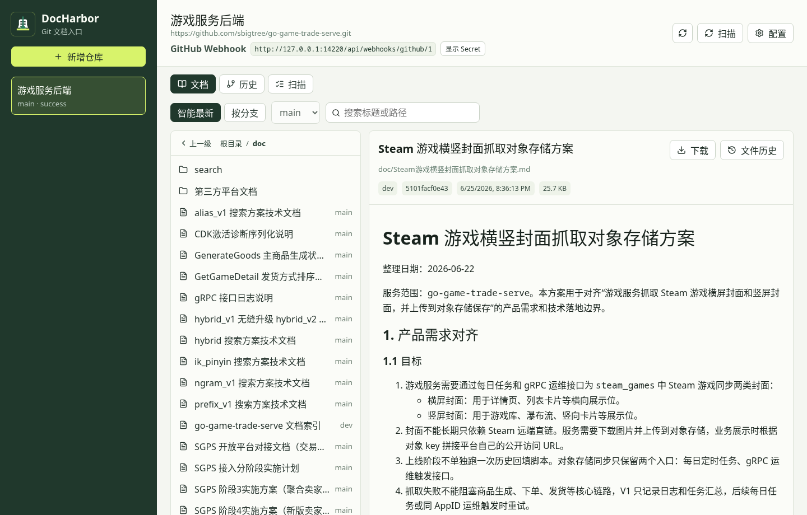
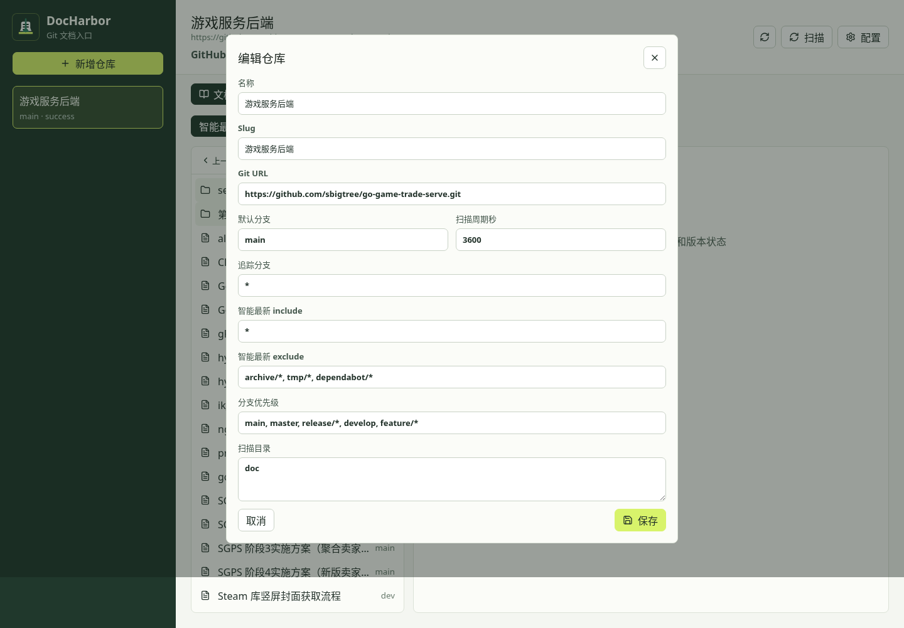
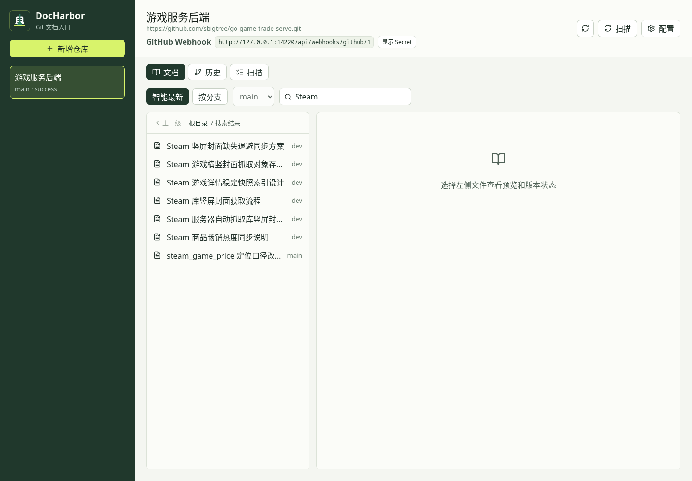
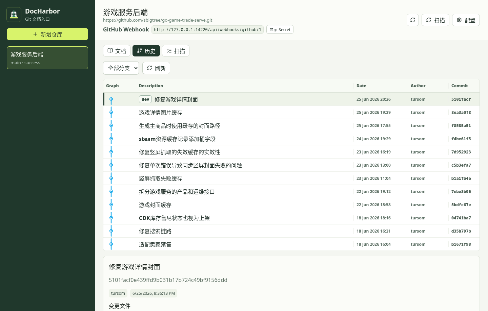
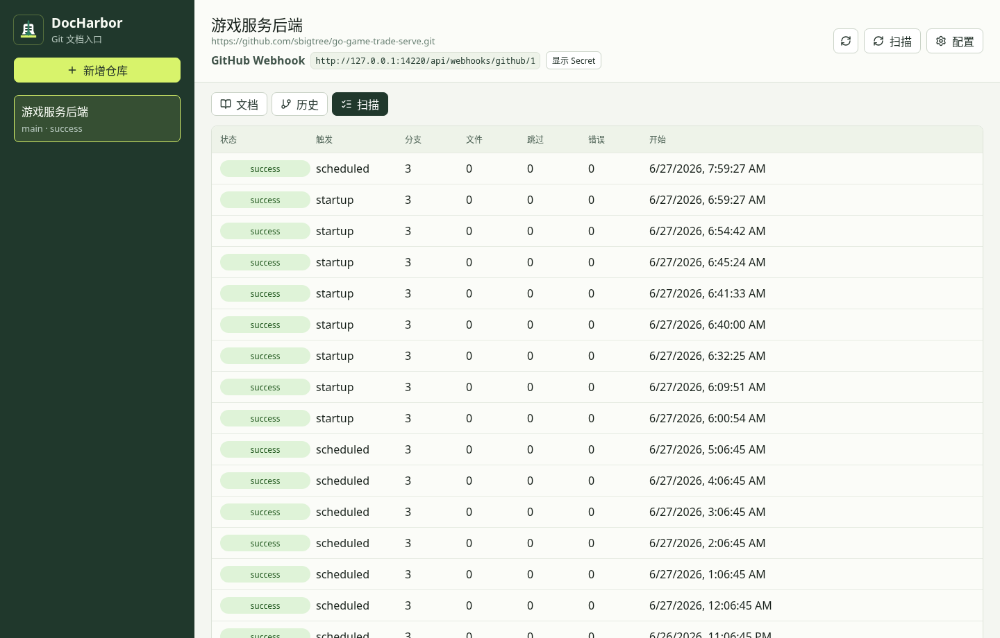
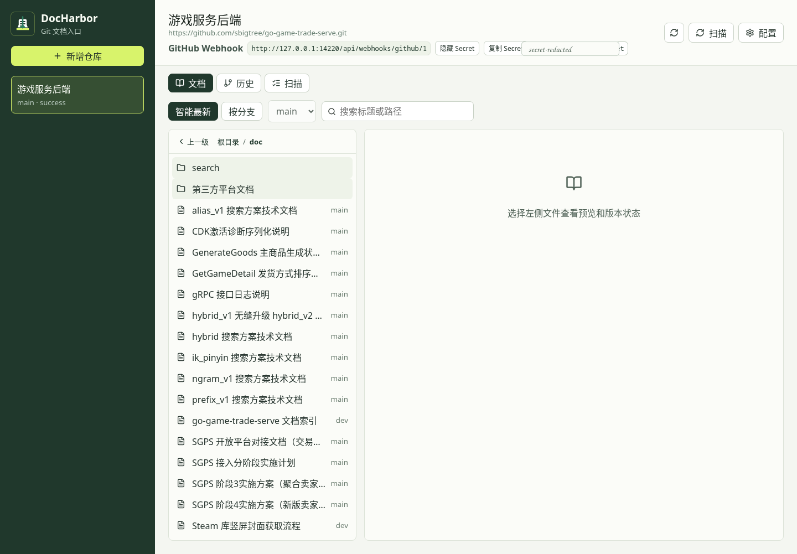

# DocHarbor 使用手册

DocHarbor 是一个面向 Git 仓库文档的浏览、预览、下载和历史查看工具。它不会接管文档编辑流程，也不会把文档写回仓库；Git 仍然是唯一可信来源，DocHarbor 只负责同步、索引和展示。

本文面向两类用户：

- 文档阅读者：查找、预览、下载文档，查看文档来源分支和最近变更。
- 仓库管理员：配置仓库、扫描目录、分支规则、GitHub Webhook 和部署访问控制。

> 截图更新说明：本文 `assets/user-guide/` 中的六张截图仍为重设计前的界面，尚未更新。导航名称、按钮位置及交互以本文新版文字和当前页面为准，旧截图仅供理解数据内容。

## 1. 快速开始

### 1.1 启动服务

本地或服务器上可以直接使用 Docker Compose：

```bash
docker compose up --build -d
```

默认访问地址：

```text
http://127.0.0.1:14220
```

生产环境建议放在 Pangolin 等网关后面，由网关负责登录和访问控制。DocHarbor 自身不维护用户、角色和登录态。

### 1.2 首次使用流程

1. 点击侧栏「仓库」分组右侧的 **+（新增仓库）**；手机先点顶部 **菜单**。
2. 填写仓库名称、Git URL、默认分支、扫描目录。
3. 点击 **添加并开始扫描**，创建成功后进入该仓库的文档页；以后可用页头 **立即扫描** 手动更新。
4. 扫描完成后进入 **文档** 页签，通过目录、搜索或分支切换查看文档。
5. 需要自动刷新时，在 GitHub 配置 Webhook。

## 2. 界面概览

DocHarbor 有八个主页面，页面跳转和分享地址如下：

| 页面 | 地址 | 位置 |
| --- | --- | --- |
| 文档 | `/` | 仓库页签 |
| 提交历史 | `/history/` | 仓库页签 |
| 扫描记录 | `/scans/` | 仓库页签 |
| 仓库设置 | `/repo-settings/` | 仓库页签 |
| AI 问答 | `/ai/` | 侧栏顶部 |
| AI 供应商 | `/ai/config/` | 侧栏「管理」 |
| AI 诊断 | `/ai/diagnostics/` | 侧栏「管理」 |
| 系统设置 | `/settings/` | 侧栏「管理」 |

侧栏仓库行显示扫描状态点和文件数。在仓库页面切换仓库时保留当前页签；在全局页面点击仓库时进入该仓库的文档页。仓库页头显示仓库名、扫描状态、Git URL、最近扫描时间和分支数，右侧为 **立即扫描**。

窄屏通过顶部 **菜单** 打开侧栏，按 Esc 可关闭并回到菜单按钮。侧栏底部可选择 **跟随系统 / 浅色 / 深色**，选择会保存在当前浏览器中。

重设计后的入口迁移：原「Git 历史」改名为「提交历史」，原「AI 配置」改名为「AI 供应商」，两者 URL 不变；原「配置」弹窗迁到「仓库设置」页；Webhook Payload URL 迁到「仓库设置」，共享 Secret 迁到「系统设置」。独立 HTML 预览仍使用 `/html-preview/`，不属于八个主页面。



## 3. 仓库配置

点击侧栏仓库分组的 **+（新增仓库）** 打开弹窗。必填区包含 Git URL、名称、默认分支（默认 `main`）和扫描目录（默认 `doc, docs`），其他字段位于 **更多选项**。扫描目录按逗号或换行拆分，点击 **添加并开始扫描** 完成创建；Esc 关闭弹窗并将焦点返回触发按钮。

编辑已有仓库时，进入该仓库的 **仓库设置** 页签。修改后底部出现「有未保存的修改」保存栏，点击 **保存** 提交，或点击 **放弃** 恢复原值；保存成功后保存栏消失。存在未保存修改时，离开或刷新页面会提示确认。字段错误显示在对应输入框下方，接口错误显示在保存栏中。



### 3.1 字段说明

| 字段 | 说明 | 示例 |
| --- | --- | --- |
| 名称 | 页面上展示的仓库名称 | 游戏服务后端 |
| Slug | 仓库标识；为空时按名称生成 | game-docs |
| Git URL | Git 远程地址，支持 SSH 和 HTTP(S) | `git@github.com:org/repo.git` |
| 默认分支 | 文档页按分支浏览的默认分支 | `main` |
| 自动拉取 Git 仓库 | 是否在服务启动时及按周期自动拉取；关闭后仍支持手动扫描和 Webhook | 默认开启 |
| 扫描周期秒 | 开启自动拉取时的后台定时扫描间隔 | `3600` |
| 追踪分支 | 需要同步和扫描的分支，支持 `*` 和通配模式 | `*`、`main, release/*` |
| 智能最新 include | 参与智能最新计算的分支范围 | `*` |
| 智能最新 exclude | 从智能最新排除的分支 | `archive/*, tmp/*, dependabot/*, backup/*` |
| 分支优先级 | 时间相同时的分支排序 | `main, master, release/*, develop` |
| 扫描目录 | 每行一个目录，只索引这些目录下的文件 | `doc`、`docs` |

### 3.2 分支规则怎么理解

默认排除 `backup/*`，避免备份分支成为“智能最新”的文档来源。升级时会执行一次迁移：仍使用旧默认排除规则（`archive/*`、`tmp/*`、`dependabot/*`）的仓库自动补上 `backup/*`，并重算已有索引，无需重新拉取 Git。自定义规则保持不变；如需排除备份分支，请自行添加 `backup/*`。


- **追踪分支** 决定哪些分支会被扫描。
- **智能最新 include/exclude** 决定哪些分支参与“智能最新”视图。
- **分支优先级** 只在多个候选文档时间相同的时候生效。
- **按分支** 浏览不受智能最新规则影响，只要该分支被扫描，就可以查看该分支 HEAD 上的文档。

常见配置：

```text
追踪分支：*
智能最新 include：*
智能最新 exclude：archive/*, tmp/*, dependabot/*, backup/*
分支优先级：main, master, release/*, develop, feature/*
扫描目录：doc
```

当前 UI 提供新增和编辑入口。后端 `DELETE /api/repos/{repoID}` 会将仓库置为停用状态，停用仓库不会继续扫描；当前页面没有单独的删除按钮，如需停用可以通过 API 或后续管理入口执行。

### 3.3 私有仓库凭据

DocHarbor 不把 Git 密钥写入数据库。凭据通过容器挂载或主机环境提供。

SSH 仓库：

- 默认 Compose 会挂载 `~/.ssh:/root/.ssh:ro`。
- 也可以把项目专用 deploy key 放到 `credentials/ssh/`，再用 `credentials/.gitconfig` 指定 `core.sshCommand`。

HTTP(S) 仓库：

- 使用 `~/.git-credentials` 或 `credentials/.git-credentials`。
- 使用 `credentials/.netrc`。
- 使用 `credentials/.gitconfig` 配置 credential helper。

示例：

```ini
[credential]
	helper = store --file /credentials/.git-credentials
```

## 4. 扫描仓库

保存仓库配置后，点击页头 **立即扫描** 手动触发同步和扫描。

扫描会做这些事：

1. 首次执行 `git clone --mirror`。
2. 后续执行 `git remote update --prune`。
3. 读取追踪分支列表。
4. 对配置的扫描目录执行 Git tree 扫描。
5. 记录文档版本、来源分支、来源 commit、最近修改时间、文件状态和路径事件。
6. 重新计算智能最新索引。

开启 **自动拉取 Git 仓库** 时，后台会按仓库配置的扫描周期定时扫描，启动服务时也会执行一次 startup 扫描。关闭后，两种自动扫描都会跳过，已索引文档仍可浏览，手动扫描及 Webhook 更新仍可使用。重新开启时，界面将扫描周期设为默认的 3600 秒，可按需修改。

通过 API 配置时，将 `sync_interval_seconds` 设置为 `-1` 即可关闭自动拉取，设置为正数即可恢复。新增仓库省略该字段或传 `0` 时默认为 3600 秒；更新仓库省略该字段或传 `0` 时保留当前设置。

## 5. 浏览文档

进入 **文档** 页签后，可以用两种视图查看文件：

- **智能最新**：按文档维度从多个分支中选出最新有效版本。
- **按分支**：查看指定分支 HEAD 上的文档树。

### 5.1 目录导航

左侧文件区支持：

- 如果仓库只配置了一个扫描目录，打开仓库时会直接进入该目录。
- 点击目录进入下一级。
- 点击 **上一级** 返回父目录。
- 点击面包屑里的任意一级目录快速跳转。
- 当前目录会写入浏览器地址，方便复制分享。

### 5.2 智能最新

智能最新不是简单展示某个分支的文件树，而是按每个文档选择候选版本：

- 只选择当前仍然存在的 active 文件。
- 优先选择文件自己的最近修改时间更晚的版本。
- 时间相同时参考分支优先级。
- 排除 `latest_exclude_branches` 命中的分支。

来源不是仓库默认分支时，文件标题下方第二行显示来源分支，长分支名省略显示，悬停可查看完整名称；默认分支文件不显示这行。文件详情顶部显示来源 commit、时间和大小，并说明智能最新选择的非默认分支。

### 5.3 按分支浏览

切换到 **按分支** 后，分支下拉框才会出现，选择后即可查看该分支上的文档；文件列表不再逐行重复显示分支。这种模式适合查看测试分支、发布分支或历史维护分支上的文档状态。

## 6. 搜索文档

在文档页顶部搜索框输入关键词并按回车，可以按标题和路径搜索当前仓库的文档。



搜索结果会显示在左侧文件区，面包屑中会显示 **搜索结果**。清空搜索词并回车，或重新进入目录，可以回到普通目录浏览。

## 7. 预览和下载

点击左侧文件后，阅读区打开文件详情。窄屏只显示文件列表或阅读区之一，阅读区顶部 **文件列表** 按钮可返回列表。

支持预览：

- Markdown 文件。
- Markdown 内的 Mermaid 代码块。
- Markdown 内的相对图片资源；相对路径会按当前文档所在目录解析，并从同一个 commit 的 Git 对象中读取。
- HTML 文件的嵌入预览，可通过阅读区 **⋯ → 独立窗口打开** 进入独立预览页；HTML 文档保留自己的白色背景。

支持下载：

- 所有被索引且允许下载的文件。
- 其他不支持预览的文件仍可以通过 **下载** 按钮下载。
- Markdown 超过预览大小限制时不会预览，但仍可以下载。

文件详情展示：

- 标题和路径。
- 来源分支。
- 来源 commit。
- 最近修改时间。
- 文件大小。
- 分支状态。
- 删除、移动、重命名等路径事件。

浏览器地址会同步当前 repo、视图、目录和版本 ID。复制地址给别人后，对方可以直接定位到同一个文档。

## 8. 文件历史和路径事件

文档右栏包含以下信息，屏幕宽度不足时移到正文下方：

- **本页目录**：Markdown 有至少两个标题时展示，点击可定位正文；HTML 不显示。
- **分支版本**：同一文档在不同分支上的状态、提交和时间，当前版本标为「当前」。
- **路径事件**：扫描识别到的删除、移动、重命名事件。

打开文件时自动加载路径事件；阅读区 **⋯ → 文件历史** 会滚动到路径事件区。没有事件时显示「没有删除、移动或重命名记录」，目前不提供在线 diff。

## 9. 提交历史

进入 **提交历史** 页签可以查看仓库级提交历史。



功能说明：

- 默认显示 **全部分支** 的提交历史。
- 选择具体分支后，只显示该分支历史。
- 左侧图形展示提交线，列表列名为「提交说明 / 作者 / 时间 / SHA」。
- 提交说明前展示分支/tag 标记；每行可用鼠标或键盘选择。
- 点击提交行后，右侧展示提交说明、SHA、作者、时间、父提交、引用和变更文件列表；窄屏详情移到列表下方，并隐藏列表的作者和 SHA 列。
- 历史页的分支选择也会写入浏览器地址，方便分享。

## 10. 扫描记录

进入 **扫描记录** 页签可以查看最近扫描记录。顶部汇总最近状态、自动拉取间隔、追踪分支数和扫描目录；有错误时会提示错误数和已更新索引文件数。



字段说明：

| 字段 | 说明 |
| --- | --- |
| 状态 | 成功、部分成功、失败、扫描中；原始状态可在提示中查看 |
| 触发方式 | 服务启动、定时、手动、Webhook；未知值保留原值 |
| 分支 | 本次扫描处理的分支数量 |
| 文件 | 本次扫描写入或处理的文件数量 |
| 跳过 | 因规则或文件状态跳过的数量 |
| 错误 | 扫描中遇到的文件级错误数量 |
| 开始 | 扫描开始时间 |
| 耗时 | 开始到完成的时间；未完成时显示「进行中」 |

有错误数或错误消息的行可以展开，查看错误消息和格式化的明细 JSON。如果扫描失败，仓库列表和扫描记录会显示错误状态。优先检查 Git URL、凭据、允许的 Git host、扫描目录和网络连通性。

## 11. GitHub Webhook

DocHarbor 支持 GitHub Webhook 自动触发扫描。每个仓库都有独立 URL：

```text
https://<你的域名>/api/webhooks/github/<repoID>
```

在 **仓库设置 → GitHub Webhook** 查看和复制当前仓库的 Payload URL；共享 Secret 的管理入口位于 **系统设置 → GitHub Webhook**。



### 11.1 配置服务端 Secret

在 **系统设置 → GitHub Webhook** 中，首次未配置时点击 **生成 Secret**，已有密钥时通过 **轮换 Secret** 和页内二次确认生成新值。服务端将随机密钥持久化到数据库。也可以在启动服务时通过环境变量提供初始共享密钥：

```bash
GITHUB_WEBHOOK_SECRET=your-random-secret docker compose up --build -d
```

所有仓库共享同一个 Secret，**数据库中的密钥优先于 `GITHUB_WEBHOOK_SECRET` 环境变量**；只有数据库未保存密钥时才使用环境变量。两者均未配置时，Webhook 入口不可用。

刷新成功后新密钥立即生效，无需重启服务；旧密钥立即失效。密钥保存在数据库中，重启后仍然有效，请持久化并备份数据库（默认位于 `DATA_DIR`，自定义 `DB_DSN` 时以实际数据库位置为准）。刷新后仅修改环境变量不会覆盖数据库中的密钥。

### 11.2 在 GitHub 仓库配置 Webhook

在 GitHub 仓库进入 `Settings -> Webhooks -> Add webhook`：

| 字段 | 值 |
| --- | --- |
| Payload URL | `https://<你的域名>/api/webhooks/github/<repoID>` |
| Content type | `application/json` |
| Secret | 与页面显示的当前有效 Secret 一致 |
| Events | `Just the push event` |

GitHub 的 `ping` 事件用于测试连通性；`push` 事件会异步触发扫描并立即返回 `202 Accepted`。

### 11.3 在 UI 显示、复制和轮换 Secret

在 **系统设置 → GitHub Webhook** 中，Secret 默认遮罩显示。点击显示按钮查看当前值，点击隐藏按钮恢复遮罩，复制按钮可将当前值复制到剪贴板。仓库设置页只展示 Payload URL 和系统设置链接，不展示 Secret。

需要更换密钥时：

1. 点击 **轮换 Secret**。页面内出现二次确认，可取消；首次点击不会轮换密钥，也不会打开浏览器原生确认框。
2. 确认后，服务端生成随机密钥并保存到数据库，可用显示和复制按钮获取新值。请求期间相关按钮禁用，失败时在对应节内显示错误信息。
3. 复制新密钥，更新所有仓库的 GitHub Webhook Secret，以及使用该密钥签名请求的 GitHub Actions 配置（直接写在 workflow 中的密钥或 Actions Secrets）。更新完成前，使用旧密钥的请求将无法通过签名校验。

刷新无需重启 DocHarbor。如果请求失败或响应丢失，可点击 **显示 Secret** 重新读取服务端当前有效值，确认刷新是否已生效。

注意：DocHarbor 自身没有用户权限系统，读取和刷新 Secret 的能力必须依赖 Pangolin 或其他外层访问控制保护。`/api/webhooks/github/secret` 的 **GET 和 POST 都必须要求认证并限制为可信管理人员访问**，不能随仓库 Webhook 接收路径一起旁路认证。

### 11.4 Pangolin 路径放行

GitHub Webhook 请求不会携带 Pangolin 登录态，所以 webhook 路径必须 **旁路认证**。

推荐规则：

```text
规则 1：
路径：/api/webhooks/github/secret
行为：传递至认证

规则 2：
路径：/api/webhooks/github/*
行为：旁路认证
```

如果 Pangolin 路径输入框不接受开头 `/`，就写：

```text
api/webhooks/github/secret
api/webhooks/github/*
```

规则 1 必须排在规则 2 前面，并同时保护 GET 和 POST，避免密钥读取或刷新接口被公开。也可以不用通配符，逐个仓库精确放行：

```text
/api/webhooks/github/1
/api/webhooks/github/2
```

## 12. 浏览器地址和分享

DocHarbor 会把主要浏览状态写入 URL：

| 参数 | 说明 |
| --- | --- |
| `repo` | 仓库 ID |
| `tab` | 旧链接兼容参数，如 `history`、`runs`、`repo-settings`、`ai`、`ai-config`、`ai-diagnostics`、`settings`；自动跳转对应静态页 |
| `view` | `latest` 或 `branch` |
| `branch` | 当前分支过滤 |
| `dir` | 当前目录 |
| `version` | 当前打开的文档版本 |
| `commit` | 提交历史中选中的完整 SHA |
| `session` | AI 问答会话 ID |
| `scope` | AI 提问范围，如 `file` |
| `question` | AI 问答预填的问题 |

常见分享方式：

- 分享文档：打开目标文件后复制浏览器地址。
- 分享目录：进入目标目录后复制地址。
- 分享某个分支视图：切到按分支并选择分支后复制地址。
- 分享提交历史：进入提交历史页，选择分支或提交后复制地址，例如 `/history/?repo=7&commit=<sha>`。
- 分享 AI 会话：打开会话后复制 `/ai/?session=<id>`，也可带仓库上下文。

文档链接如 `/?repo=7&version=42`，仓库设置链接如 `/repo-settings/?repo=7`。旧 `/?tab=history&repo=7&branch=release%2F1` 仍可跳转到提交历史，并恢复仓库和分支。

### 12.1 AI 问答和管理入口

**AI 问答** 位于侧栏顶部。可查看已有会话或新建会话，选择全部仓库、当前仓库或当前文件作为提问范围；阅读文档时点击 **基于本文提问** 可带入文件上下文。Enter 发送，Shift+Enter 换行；输入法组合中的 Enter 只用于选词，不发送。回答附带引用，证据区可切换「引用 / 候选服务 / 检索过程」。窄屏通过 **会话** 按钮打开会话抽屉，证据区位于对话下方。

**AI 供应商** 位于侧栏「管理」，展示启用状态、路由顺序、密钥存储状态、最近测试和供应商表格。通过 **新增供应商** 或行内 **编辑** 打开抽屉；已配置的 API Key 不会再次完整显示，留空表示不修改。待应用配置可点击 **应用配置**；停用和删除需要二次确认。

**AI 诊断** 需要具有 `ai.diagnostics.read` 能力的 Token。输入 Token 后可按状态、关键词读取 Run，查看检索轮次、契约覆盖、步骤和数据源。未输入 Token 时不会自动读取受保护的诊断数据。

**系统设置 → 访问令牌** 可以签发临时 Token，有效期可选 1 小时、8 小时、24 小时或自定义（300–86400 秒）。Viewer Key 留空表示不限制；能力通过 **AI 历史读取** 和 **AI 问答排查** 复选框选择。Token 只显示一次，签发后立即复制保存。

## 13. 部署和运行配置

### 13.1 Docker Compose

```bash
docker compose up --build -d
```

当前 Compose 默认监听：

```text
http://127.0.0.1:14220
```

如果使用 GHCR 镜像，也可以直接拉取：

```bash
docker pull ghcr.io/tursom/doc-harbor:latest
```

DocHarbor 镜像默认使用 `tini` 作为入口，`docker-compose.yml` 也启用了 `init: true`。这个 init 进程用于回收 Git 命令产生的孤儿子进程，生产部署不要移除；如果运行平台覆盖镜像入口，需要同步提供等价 init/reaper。已经存在的 `git <defunct>` 僵尸进程需要重启当前容器后才会清理。

### 13.2 常用环境变量

| 环境变量 | 默认值 | 说明 |
| --- | --- | --- |
| `DATA_DIR` | `./data` | SQLite 和 bare mirror 数据目录 |
| `HTTP_ADDR` | `:8080` | HTTP 监听地址；Compose 中为 `:14220` |
| `ALLOWED_CLIENT_CIDRS` | 空 | 允许访问 HTTP 服务的来源网段，逗号分隔 IPv4/IPv6 CIDR；空表示不限制，非法网段阻止启动 |
| `DB_DSN` | `${DATA_DIR}/doc-harbor.db` | SQLite DSN |
| `GIT_BIN` | `git` | Git 命令路径 |
| `WEB_DIR` | `./web/dist` | 静态前端目录 |
| `DEFAULT_SCAN_INTERVAL` | `3600` | 默认扫描间隔秒数 |
| `MAX_PREVIEW_FILE_SIZE` | `2097152` | Markdown 预览大小上限 |
| `ALLOWED_GIT_HOSTS` | 空 | Git host 白名单，逗号分隔；空表示不限制 |
| `ALLOW_LOCAL_GIT` | `0` | 是否允许本地路径或 `file://` 仓库 |
| `GITHUB_WEBHOOK_SECRET` | 空 | 数据库未保存密钥时使用的 GitHub Webhook 共享 Secret；数据库密钥优先 |

AI provider API key 通过前端 AI 供应商页的新增或编辑抽屉录入。DocHarbor 会在 `DATA_DIR/secrets/ai-master.key` 自动生成本机加密主密钥，并随数据目录持久化；不需要额外配置环境变量。

可以通过 `ALLOWED_CLIENT_CIDRS` 限制来源网段，例如：

```bash
ALLOWED_CLIENT_CIDRS='192.168.10.0/24,10.20.0.0/16,127.0.0.1/32,::1/128' docker compose up -d
```

直接运行程序时也使用同名环境变量。配置修改后需重启程序或重新创建容器。单个 IPv4 主机用 `/32`，单个 IPv6 主机用 `/128`；多个网段满足任意一个即可访问。未配置时不限制，配置后网段外来源返回 HTTP 403，规则适用于页面、API、健康检查和 Webhook，不隐式放行本机。

来源以 TCP 连接对端为准，不使用 `X-Forwarded-For`、`X-Real-IP` 或 `Forwarded` 请求头。经过 Pangolin、反向代理或 Docker 网络地址转换时，应按应用实际看到的连接来源配置；如需限制代理前的原始访客网段，请在代理层配置。直接调用 Webhook 的 GitHub Actions runner 也必须满足来源限制，否则更新通知会被拒绝。


### 13.3 数据和凭据挂载

Compose 默认挂载：

```text
./data:/data
~/.ssh:/root/.ssh:ro
./credentials:/credentials:ro
~/.git-credentials:/root/.git-credentials:ro
~/.gitconfig:/root/.gitconfig:ro
```

建议：

- `./data` 需要持久化备份。
- `credentials/` 不要提交真实凭据。
- 生产环境使用只读 deploy key 或专用 token。
- 如果使用 HTTP(S) Git，确认 `.git-credentials` 或 `.netrc` 在容器内可读。

## 14. 安全边界

DocHarbor 的安全边界是：

- 不内建用户系统。
- 不内建页面权限。
- 访问控制交给 Pangolin 或其他反向代理。
- GitHub Webhook 通过 HMAC-SHA256 校验 `X-Hub-Signature-256`。
- 默认禁止本地 Git URL，避免任意本机路径 clone。
- Markdown HTML 会在前端 sanitize 后渲染。
- Mermaid 渲染失败时降级为原始代码块。

必须保护的路径：

```text
/api/webhooks/github/secret
```

必须旁路认证的路径：

```text
/api/webhooks/github/<repoID>
```

## 15. 故障排查

### 15.1 仓库 clone 或 fetch 失败

检查：

- Git URL 是否正确。
- 容器内是否能解析和访问 Git host。
- SSH key 是否挂载到 `/root/.ssh`。
- HTTP(S) token 是否挂载到 `/root/.git-credentials` 或 `/credentials/.netrc`。
- `ALLOWED_GIT_HOSTS` 是否包含目标 host。
- 本地路径或 `file://` 是否被 `ALLOW_LOCAL_GIT=0` 拦截。

### 15.2 文档列表为空

检查：

- 是否点击过 **立即扫描**，或新增仓库后自动扫描是否完成。
- 扫描目录是否写对，例如 `doc` 和 `docs` 不同。
- 追踪分支是否匹配实际分支。
- 文件是否在扫描目录下。
- 文件是否被隐藏目录、临时文件规则或大小限制跳过。
- 智能最新是否被 include/exclude 规则排除了。

### 15.3 Markdown 不预览

检查：

- 文件扩展名是否为 Markdown。
- 文件大小是否超过 `MAX_PREVIEW_FILE_SIZE`。
- 右侧是否显示“当前文件不支持预览”。如果显示，仍可使用下载。

### 15.4 Mermaid 渲染失败

Mermaid 代码块语法错误时，DocHarbor 会保留原始代码块并显示错误。先把 Mermaid 片段放到 Mermaid Live Editor 或本地工具中校验语法，再提交到 Git。

### 15.5 GitHub Webhook 不触发扫描

检查：

- 数据库中是否已生成 Secret，或是否配置了 `GITHUB_WEBHOOK_SECRET`。
- GitHub Webhook Secret 是否和页面显示的服务端当前有效值一致；刷新后是否已更新所有仓库的 Webhook 和相关 Actions 签名密钥。
- GitHub Webhook Content type 是否为 `application/json`。
- GitHub 事件是否选择了 push。
- Pangolin 是否对 `/api/webhooks/github/<repoID>` 设置了旁路认证。
- Pangolin 是否仍然保护 `/api/webhooks/github/secret`。
- 扫描记录里是否出现 `github_webhook`。

### 15.6 页面能打开但分享链接定位不对

检查链接里是否包含：

- `repo=<id>`
- 页面路径是否正确，例如 `/history/`、`/ai/`（旧链接可保留 `tab` 参数）
- `view=latest|branch`
- `dir=<目录>`
- `version=<文档版本 ID>`
- 提交历史的 `commit=<sha>` 或 AI 问答的 `session=<会话 ID>`

如果仓库被停用、文档版本被重新索引或数据目录被重建，旧链接可能无法定位到同一个版本。

## 16. API 和自动化能力

DocHarbor 的 UI 使用同一组 HTTP API。自动化脚本可以直接调用这些接口，但仍需要通过 Pangolin 或部署侧网络策略控制访问。

常用接口：

| 方法 | 路径 | 说明 |
| --- | --- | --- |
| `GET` | `/api/health` | 健康检查 |
| `GET` | `/api/repos` | 仓库列表 |
| `POST` | `/api/repos` | 新增仓库 |
| `PATCH` | `/api/repos/{repoID}` | 更新仓库配置 |
| `DELETE` | `/api/repos/{repoID}` | 停用仓库 |
| `POST` | `/api/repos/{repoID}/scan` | 手动扫描 |
| `GET` | `/api/repos/{repoID}/branches` | 已扫描分支 |
| `GET` | `/api/repos/{repoID}/files` | 当前目录文件列表 |
| `GET` | `/api/repos/{repoID}/search` | 搜索文档 |
| `GET` | `/api/repos/{repoID}/versions/{versionID}/content` | 文档预览内容 |
| `GET` | `/api/repos/{repoID}/versions/{versionID}/download` | 下载已索引版本 |
| `GET` | `/api/repos/{repoID}/history` | 仓库提交历史 |
| `GET` | `/api/repos/{repoID}/commits/{sha}` | commit 详情和变更文件 |
| `GET` | `/api/repos/{repoID}/scan-runs` | 扫描记录 |
| `GET` | `/api/webhooks/github/secret` | 读取当前有效共享密钥，返回 `{configured, secret}`；必须保护访问 |
| `POST` | `/api/webhooks/github/secret` | 生成随机共享密钥并持久化到数据库，返回 `{configured, secret}`；必须保护访问 |
| `POST` | `/api/webhooks/github/{repoID}` | GitHub Webhook |

Secret 的 GET 接口保留原有返回结构：`configured` 为布尔值，`secret` 为字符串。POST 无需请求体，成功返回相同结构（`configured: true`，`secret` 为新密钥）。每次 POST 都会更换所有仓库共享的密钥，立即使旧值失效，无需重启；不要自动重试刷新请求，响应不确定时先 GET 确认当前值。自动化调用同样必须通过外层认证，避免在日志中输出返回的明文密钥。

构建发布：

- 仓库包含 GitHub Actions 工作流，push 到 `master` 或 `v*` tag 会构建并推送 `ghcr.io/tursom/doc-harbor`。
- `master` 分支会生成 `latest`、`master`、`sha-<shortsha>` 标签。
- `v*` tag 会生成对应版本标签。
- `docker-compose.yml` 同时保留 `build: .` 和 `image: ghcr.io/tursom/doc-harbor:latest`，既可本地构建，也可使用 GHCR 镜像名称。

## 17. 当前限制

- 不支持在线编辑文档。
- 不支持目录打包 zip 下载。
- 不支持评论、审批、收藏等协作功能。
- 不支持内置用户权限；必须依赖外层网关。
- Markdown 和 HTML 之外的文件不做在线预览，仍可下载。
- 智能最新主要按规范化路径识别文档身份，rename/move 事件用于历史展示和后续增强。
